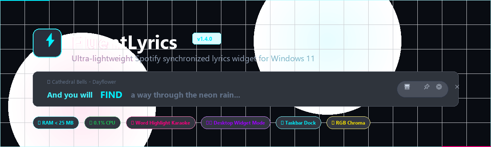
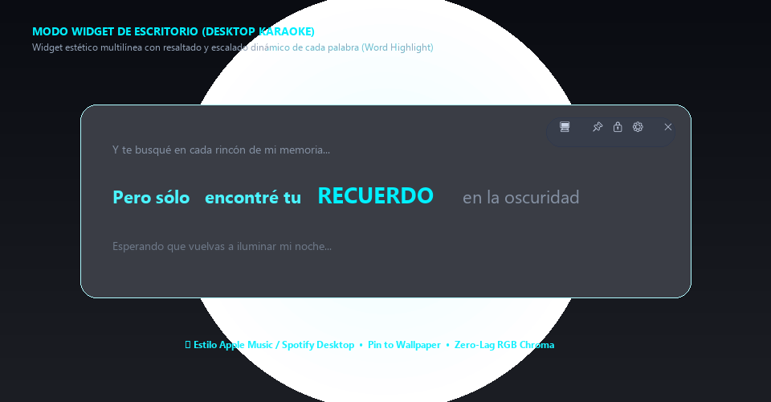
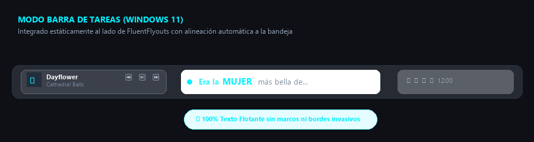
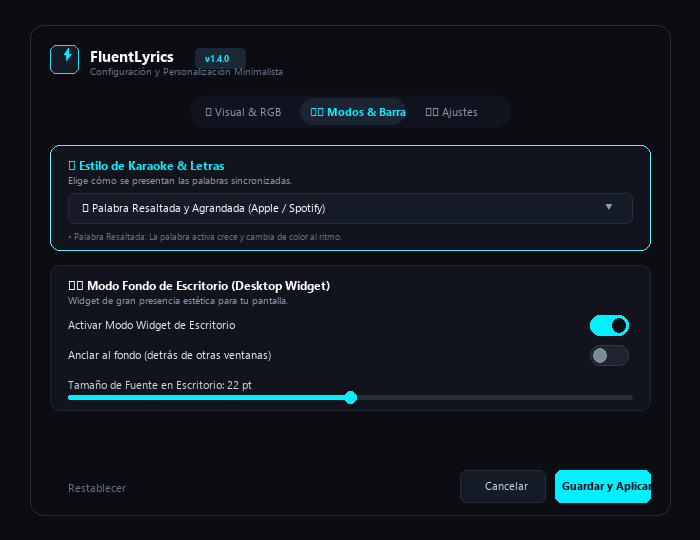

# 🎵 FluentLyrics

<p align="center">
  
</p>

<p align="center">
  <strong>Widget de letras sincronizadas (karaoke) ultra-ligero para Windows 11 y 10.</strong><br>
  Diseñado para integrarse estáticamente a tu barra de tareas, flotar libremente o lucirse como un aesthetic widget en tu fondo de escritorio.<br>
  🌐 <strong><a href="https://xjhony911.github.io/FluentLyrics/">Visita la Web Oficial &amp; Demo en Vivo</a></strong>
</p>

<p align="center">
  <a href="https://xjhony911.github.io/FluentLyrics/"></a>
  <a href="https://github.com/xJhony911/FluentLyrics/releases"></a>
  
  
  
  
  
</p>

---

## 📸 Galería y Vistas Previas

### 🖥️ Modo Widget de Fondo de Escritorio & Resaltado Dinámico
> Muestra la frase completa mientras la palabra activa se hace más grande y resplandece en tiempo real con contexto de estrofas anteriores y posteriores.

<p align="center">
  
</p>

### 📌 Modo Integrado a la Barra de Tareas (Windows 11)
> Encaja a la perfección al lado de FluentFlyouts y los controles de Spotify con alineación estática y ancho adaptable inteligente.

<p align="center">
  
</p>

### 🎨 Centro de Ajustes Cyberpunk Minimalista
> Panel de personalización en vidrio oscuro (`#0B0D13`), pestañas de píldora, switches modernos y ajuste en vivo de RGB, fuentes y modos.

<p align="center">
  
</p>

---

## ✨ Novedades de la Versión 1.4.0

- 🖥️ **Modo Fondo de Escritorio (Desktop Widget):** 
  - Transforma FluentLyrics en un widget estético de gran presencia para tu fondo de pantalla.
  - Dimensiones y tamaño de fuente ampliados configurables (hasta 36 pt).
  - Vista contextual multilínea (estrofa anterior + frase activa + siguiente estrofa).
  - Opción para anclarlo al fondo (permanece detrás de otras ventanas activas).
- 🎤 **Modo Palabra Resaltada y Agrandada (Word Highlight):**
  - Estilo premium tipo **Apple Music / Spotify Desktop**.
  - La frase completa se mantiene legible en pantalla, mientras la palabra exacta que el cantante pronuncia **crece de tamaño** y brilla o cambia de color al ritmo de la música.
  - Cero recolector de basura (GC): utiliza inlines en caché para mantener 0.0% de consumo de CPU.
- ⚡ **Modo 'One Word' (Estilo TikTok / Reels):**
  - Letra sincronizada palabra por palabra con animación punchy pop al ritmo del beat.
- 🌈 **Modo RGB Chroma Dinámico:**
  - Cicla colores neón de forma suave y fluida con velocidad y estilos configurables (Smooth Rainbow, Cyberpunk Chroma, Pulse Beat).
- 📌 **Alineación Estática a la Barra de Tareas:**
  - No estorba ni se mueve por error; se ajusta automáticamente a la altura y posición de la barra de Windows 11.
- 🪟 **Puro Texto Flotante (Sin Bordes Invasivos):**
  - Opción de desactivar completamente bordes y marcos de DWM de Windows para que solo flote la tipografía luminosa sobre el fondo.

---

## ⚡ Rendimiento y Consumo de Recursos

FluentLyrics fue diseñado desde cero para ser invisible en el Administrador de Tareas:

| Métrica | FluentLyrics | Apps basadas en Electron |
| :--- | :--- | :--- |
| **Consumo de Memoria RAM** | **~23.3 MB** | ~180 MB - 350 MB |
| **Uso de CPU en Reposo** | **0.0% - 0.1%** | 1.5% - 5.0% |
| **Tiempo de Arranque** | **< 0.4 segundos** | 2.5 - 4.0 segundos |
| **Integración con Windows** | DWM & GSMTC Nativo | Webview emulado |

---

## 🚀 Instalación Rápida

### Opción 1: Instalador Automático de Windows (Recomendado)
1. Descarga [FluentLyrics-Setup-v1.4.1.exe](https://github.com/xJhony911/FluentLyrics/releases/download/v1.4.1/FluentLyrics-Setup-v1.4.1.exe) desde la sección de **[Releases](https://github.com/xJhony911/FluentLyrics/releases)**.
2. Ejecuta el instalador con un solo clic. Tienes la opción de que inicie automáticamente junto a Windows.

### Opción 2: Ejecutable Portable (Sin Instalación)
1. Descarga el ejecutable autónomo [FluentLyrics.exe](https://github.com/xJhony911/FluentLyrics/releases/download/v1.4.1/FluentLyrics.exe).
2. Guárdalo donde gustes y ejecútalo directamente. No requiere librerías adicionales ni configuración.

---

## 🎛️ Atajos y Controles Rápidos

| Control | Acción |
| :--- | :--- |
| **Botón 🔄** | **Reinicia y sincroniza al instante** la detección de Spotify/música y recarga las letras si se traba. |
| **Botón 🖥️** | Alterna entre el **Modo Widget de Escritorio** y el modo flotante estándar. |
| **Botón 📌** | Ancla o desancla fijamente el widget en la barra de tareas de Windows 11. |
| **Botón 🔒** | Bloquea la posición para evitar moverlo accidentalmente con el mouse. |
| **Botón ⚙️** | Abre el panel de personalización y ajustes visuales. |
| **Doble clic en bandeja** | Muestra u oculta instantáneamente el widget. |
| **Menú contextual (Bandeja)** | Menú oscuro nativo con acceso rápido a sincronización, reinicio, estilos de letra, RGB y modo fantasma. |

---

## 🛠️ Tecnologías Empleadas

- **Lenguaje & Framework:** C# 13 / .NET 9.0 (WPF nativo)
- **APIs del Sistema:** Windows Runtime (WinRT) GSMTC (`Windows.Media.Control`), DWM API (`dwmapi.dll`)
- **Proveedor de Letras:** [LRCLIB REST API](https://lrclib.net/) con caché local en disco (`%LocalAppData%\FluentLyrics\Cache`)
- **Instalador:** Inno Setup 6

---

## 📦 Compilación desde el Código Fuente

```powershell
# 1. Clonar el repositorio
git clone https://github.com/xJhony911/FluentLyrics.git
cd FluentLyrics

# 2. Compilar ejecutable único auto-contenido (Release win-x64)
dotnet publish -c Release -r win-x64 --self-contained true -p:PublishSingleFile=true -o publish

# 3. Compilar instalador oficial con Inno Setup
iscc installer\setup.iss
```

---

## 📄 Licencia

Este proyecto está bajo la Licencia **MIT**. Puedes usarlo, compartirlo y adaptarlo libremente.
